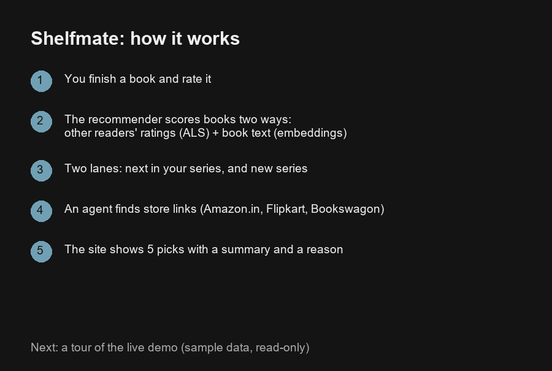

# Shelfmate

Shelfmate recommends your next book after you finish one, explains why, and links to stores that stock it.

## Demo

**Live demo (read-only, sample data):** https://shelfmate-9n5kpqosk-punit-84e9.vercel.app/



The GIF starts with a title card on how it works (rate a book, score it two ways, split into two lanes, find store links, show 5 picks). It then tours the sample data: both lanes, genre filter, shelves and dashboard.

The hosted site runs in demo mode (`NEXT_PUBLIC_DEMO=1`): it serves a small sample, because the full stack (Postgres, SearXNG, torch, Ollama) is not hosted. To deploy it: import the repo in Vercel, set Root Directory to `site`, add `NEXT_PUBLIC_DEMO=1`, deploy. The full app runs locally, see below.

## Architecture

```
Next.js website --> FastAPI --> Postgres + pgvector
                         |  \--> LangGraph agent --> SearXNG (store search), Ollama (LLM)
Weekly worker ----------/
```

The API, website and worker run from one Docker image. Recommendations combine an ALS collaborative model with
embedding similarity on book text (title, description, genres).

## Results

Hidden-book test on 2,000 readers (`scripts/evaluate.py`, logged to MLflow):

| Model      | precision@5 | recall@5 |
|------------|-------------|----------|
| Popularity | 0.100       | 0.034    |
| ALS        | 0.293       | 0.098    |

Summaries are checked against the book description; `scripts/summary_report.py` prints the grounding pass rate.

## Tech stack

| Part | Tool |
|------|------|
| API | FastAPI, uvicorn |
| Website | Streamlit (first version) and Next.js in `site/` (port 3000) |
| Database | Postgres + pgvector, SQLAlchemy, Alembic |
| Recommender | implicit (ALS), sentence-transformers (embeddings) |
| Agent and LLM | LangGraph, Ollama |
| Store search | SearXNG |
| Weekly flow | Prefect |
| Experiments | MLflow |
| Tooling | uv, ruff, pytest, pre-commit, GitHub Actions, Docker Compose |

## Run it locally

Needs Docker, [uv](https://docs.astral.sh/uv/) and [Ollama](https://ollama.com) running on the host.

```powershell
git clone https://github.com/Punit-7/shelfmate.git
cd shelfmate
Copy-Item .env.example .env                                    # set DB_PASSWORD, email settings
Copy-Item searxng/settings.example.yml searxng/settings.yml    # set a real secret_key
docker compose up -d db search

uv sync
uv run python scripts/download_data.py
uv run alembic upgrade head
uv run python -m shelfmate.data.load_books
uv run python -m shelfmate.data.load_ratings
uv run python -m shelfmate.data.load_genres
uv run python -m shelfmate.recommender.embed_books

docker compose up -d --build
```

Website: http://localhost:3000 · API docs: http://localhost:8000/docs · `docker compose ps` shows the API and site as healthy. The first website, in Streamlit, is in `app/` for reference and no longer runs.

### Run the API and the website

Docker (the API image contains a copy of `src/`, so rebuild after code changes):

```powershell
docker compose up -d --build api site
```

Local development (no rebuild; the API reloads when you save):

```powershell
docker compose up -d db search                                  # database and search only
uv run uvicorn shelfmate.api.main:app --reload --port 8000      # terminal 1: the API
cd site; npm install; npm run dev                               # terminal 2: the website on port 3000
```

The API loads the agent once at startup. If the agent still gives an old answer after you change `src/shelfmate/agent/`, restart the API. The website finds the API at `http://127.0.0.1:8000` unless `API_URL` says otherwise.

### Ask the agent

The "Ask Shelfmate" box on the Recommendations page answers in plain English. It can:
- recommend next books from your shelves ("what should I read next?")
- find books like a book, series or genre ("something like Dune")
- list an author's books ("r.f. kuang's books"). It uses the local catalogue first and Open Library when the author is not there
- find store links and audiobook links
- log a finished book with a rating ("I finished Golden Son, 5 stars")

It only names books and links that a tool returned. Ollama must be running on the host.

Browser tests for the Next.js site (they change real data and put it back): `cd site && PW_CHANNEL=msedge npm run test:e2e`, with the stack running. Without Edge, run `npx playwright install chromium` once and leave `PW_CHANNEL` unset.
Logs are JSON in `logs/`; `uv run python scripts/log_report.py` summarises them.

## Limits and next steps

- Price coverage is low: shops block automated search, so the app shows store links, not prices.
- The dataset (goodbooks-10k) stops around 2017.
- ALS retrains on every start (about a minute).
- The Next.js site (`site/`) has the shelves, recommendations, add-book and dashboard pages. Streamlit is still the first version and will be removed once the Next.js site covers everything.
